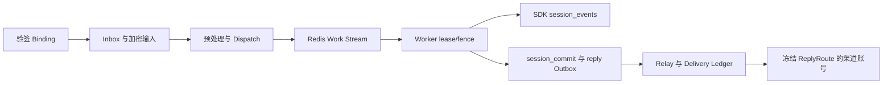
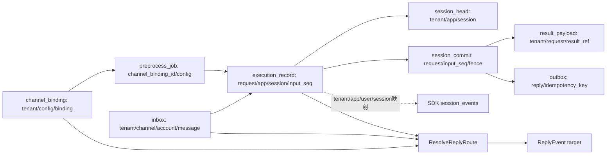

# 故障恢复后继续对话 — 设计文档

## 模块与数据流

## 数据层权威与事务边界

下表逐字段来自当前迁移，包含默认值、空值和表内约束；唯一键、外键和索引随表列出。DDL 原文位于 REFERENCE-IMPLEMENTATION，直观阅读优先使用这些表格。

官方 SDK `session_events` 保存聊天转写，`app_name=tenant_id + "/" + agent_app_id`，配合 user_id/session_id。平台 `session_head/session_commit` 保存顺序、fence、终态和 Outbox 协调。SDK 同步持久化与平台 terminal 事务是两个边界：平台 Rollback 不撤销已写的 SDK 事件，故障重跑可留下重复输入或孤立工具调用痕迹；不能把“一个 terminal commit”写成“所有聊天事件一次且全原子”。

状态表都带 tenant；有意复用基础设施不会改变租户作用域。payload/result/tool result 使用租户密钥版本，解密及摘要校验失败拒绝恢复。

### `channel_binding`

| 字段 | 类型、默认值与空值约束 | 直观用途 |
|---|---|---|
| `tenant_id` | `text NOT NULL` | 租户强制边界 |
| `config_version` | `bigint NOT NULL` | 绑定的配置版本 |
| `binding_id` | `text NOT NULL` | Bot Binding 身份 |
| `channel` | `text NOT NULL` | 渠道类型 |
| `external_account_id` | `text NOT NULL` | 渠道账号 |
| `agent_app_id` | `text NOT NULL` | 租户内 agent 应用 |
| `secret_ref` | `text NOT NULL` | 渠道验签密钥引用，非密钥明文 |
| `secret_version` | `bigint NOT NULL` | 验签密钥固定版本 |
| `created_at` | `timestamp with time zone DEFAULT now() NOT NULL` | 创建审计时间 |
| `send_secret_ref` | `text` | 渠道发送凭据引用，可与验签凭据不同 |
| `send_secret_version` | `bigint` | 渠道发送凭据固定版本 |

表内约束：

- `CONSTRAINT channel_binding_secret_version_check CHECK ((secret_version >= 1))`
- `CONSTRAINT channel_binding_send_secret_complete CHECK ((((send_secret_ref IS NULL) AND (send_secret_version IS NULL)) OR ((length(btrim(send_secret_ref)) > 0) AND (send_secret_version >= 1))))`

主键/唯一键/外键见参考实现对应 DDL；主要约束：

- `ALTER TABLE ONLY public.channel_binding     ADD CONSTRAINT channel_binding_pkey PRIMARY KEY (tenant_id, config_version, binding_id);`
- `ALTER TABLE ONLY public.channel_binding     ADD CONSTRAINT channel_binding_tenant_id_config_version_channel_external_a_key UNIQUE (tenant_id, config_version, channel, external_account_id);`
- `ALTER TABLE ONLY public.channel_binding     ADD CONSTRAINT channel_binding_tenant_id_agent_app_id_fkey FOREIGN KEY (tenant_id, agent_app_id) REFERENCES public.agent_app(tenant_id, agent_app_id);`
- `ALTER TABLE ONLY public.channel_binding     ADD CONSTRAINT channel_binding_tenant_id_config_version_fkey FOREIGN KEY (tenant_id, config_version) REFERENCES public.config_snapshot(tenant_id, config_version);`

### `inbox`

| 字段 | 类型、默认值与空值约束 | 直观用途 |
|---|---|---|
| `tenant_id` | `text NOT NULL` | 租户强制边界 |
| `channel` | `text NOT NULL` | 渠道类型 |
| `external_account_id` | `text NOT NULL` | 渠道账号 |
| `external_message_id` | `text NOT NULL` | 渠道原消息去重身份 |
| `request_id` | `text NOT NULL` | 内部原始输入身份 |
| `agent_app_id` | `text NOT NULL` | 租户内 agent 应用 |
| `session_id` | `text` | 原会话身份 |
| `input_seq` | `bigint` | 会话内输入顺序 |
| `state` | `text NOT NULL` | 本层状态；与其他表状态不能混用 |
| `payload_ref` | `text NOT NULL` | 持久化内容引用 |
| `payload_digest` | `text NOT NULL` | 输入摘要 |
| `terminal_reason` | `text` | 业务终态原因 |
| `result_ref` | `text` | 已冻结结果引用 |
| `key_version` | `bigint NOT NULL` | 租户密钥版本 |
| `version` | `bigint DEFAULT 0 NOT NULL` | 乐观并发版本 |
| `created_at` | `timestamp with time zone DEFAULT now() NOT NULL` | 创建审计时间 |
| `updated_at` | `timestamp with time zone DEFAULT now() NOT NULL` | 最近更新审计时间 |
| `external_chat_id` | `text DEFAULT ''::text NOT NULL` | 渠道会话 |
| `external_user_id` | `text DEFAULT ''::text NOT NULL` | 渠道用户 |

表内约束：

- `CONSTRAINT inbox_input_seq_check CHECK (((input_seq IS NULL) OR (input_seq >= 1)))`
- `CONSTRAINT inbox_key_version_check CHECK ((key_version >= 1))`
- `CONSTRAINT inbox_payload_digest_check CHECK ((payload_digest ~ '^[0-9a-f]{64}$'::text))`
- `CONSTRAINT inbox_state_check CHECK ((state = ANY (ARRAY['preprocess_pending'::text, 'dispatch_pending'::text, 'dispatch_ready'::text, 'terminal'::text])))`
- `CONSTRAINT inbox_version_check CHECK ((version >= 0))`

主键/唯一键/外键见参考实现对应 DDL；主要约束：

- `ALTER TABLE ONLY public.inbox     ADD CONSTRAINT inbox_pkey PRIMARY KEY (tenant_id, channel, external_account_id, external_message_id);`
- `ALTER TABLE ONLY public.inbox     ADD CONSTRAINT inbox_tenant_id_request_id_key UNIQUE (tenant_id, request_id);`
- `ALTER TABLE ONLY public.inbox     ADD CONSTRAINT inbox_tenant_id_agent_app_id_fkey FOREIGN KEY (tenant_id, agent_app_id) REFERENCES public.agent_app(tenant_id, agent_app_id);`

### `session_head`

| 字段 | 类型、默认值与空值约束 | 直观用途 |
|---|---|---|
| `tenant_id` | `text NOT NULL` | 租户强制边界 |
| `agent_app_id` | `text NOT NULL` | 租户内 agent 应用 |
| `session_id` | `text NOT NULL` | 原会话身份 |
| `version` | `bigint DEFAULT 0 NOT NULL` | 乐观并发版本 |
| `last_fence` | `bigint DEFAULT 0 NOT NULL` | 已提交的最大 fence |
| `last_session_seq` | `bigint DEFAULT 0 NOT NULL` | 平台 session_event 序号 |
| `next_input_seq` | `bigint DEFAULT 1 NOT NULL` | 下一可执行输入序号 |
| `last_allocated_input_seq` | `bigint DEFAULT 0 NOT NULL` | 已分配的最大输入序号 |
| `state_json` | `jsonb DEFAULT '{}'::jsonb NOT NULL` | 平台协调状态，不是 SDK 聊天历史副本 |
| `summary_id` | `text` | 平台摘要引用 |
| `created_at` | `timestamp with time zone DEFAULT now() NOT NULL` | 创建审计时间 |
| `updated_at` | `timestamp with time zone DEFAULT now() NOT NULL` | 最近更新审计时间 |

表内约束：

- `CONSTRAINT session_head_last_allocated_input_seq_check CHECK ((last_allocated_input_seq >= 0))`
- `CONSTRAINT session_head_last_fence_check CHECK ((last_fence >= 0))`
- `CONSTRAINT session_head_last_session_seq_check CHECK ((last_session_seq >= 0))`
- `CONSTRAINT session_head_next_input_seq_check CHECK ((next_input_seq >= 1))`
- `CONSTRAINT session_head_version_check CHECK ((version >= 0))`

主键/唯一键/外键见参考实现对应 DDL；主要约束：

- `ALTER TABLE ONLY public.session_head     ADD CONSTRAINT session_head_pkey PRIMARY KEY (tenant_id, agent_app_id, session_id);`
- `ALTER TABLE ONLY public.session_head     ADD CONSTRAINT session_head_tenant_id_agent_app_id_fkey FOREIGN KEY (tenant_id, agent_app_id) REFERENCES public.agent_app(tenant_id, agent_app_id);`

### `session_commit`

| 字段 | 类型、默认值与空值约束 | 直观用途 |
|---|---|---|
| `tenant_id` | `text NOT NULL` | 租户强制边界 |
| `agent_app_id` | `text NOT NULL` | 租户内 agent 应用 |
| `session_id` | `text NOT NULL` | 原会话身份 |
| `commit_id` | `text NOT NULL` | 幂等提交身份 |
| `request_id` | `text NOT NULL` | 内部原始输入身份 |
| `request_digest` | `text NOT NULL` | 提交内容与请求校验 |
| `input_seq` | `bigint NOT NULL` | 会话内输入顺序 |
| `stage` | `text NOT NULL` | intermediate/terminal 提交阶段 |
| `outcome` | `text NOT NULL` | 业务执行结果 |
| `fence` | `bigint NOT NULL` | 本次执行 fencing token |
| `session_version` | `bigint NOT NULL` | 本次提交后的会话版本 |
| `reply_cursor` | `text` | 回复游标 |
| `result_ref` | `text` | 已冻结结果引用 |
| `created_at` | `timestamp with time zone DEFAULT now() NOT NULL` | 创建审计时间 |

表内约束：

- `CONSTRAINT session_commit_fence_check CHECK ((fence >= 1))`
- `CONSTRAINT session_commit_input_seq_check CHECK ((input_seq >= 1))`
- `CONSTRAINT session_commit_outcome_check CHECK ((outcome = ANY (ARRAY['pending'::text, 'queued'::text, 'running'::text, 'waiting_confirmation'::text, 'succeeded'::text, 'denied'::text, 'failed'::text, 'cancelled'::text, 'confirmation_denied'::text, 'confirmation_timeout'::text])))`
- `CONSTRAINT session_commit_request_digest_check CHECK ((request_digest ~ '^[0-9a-f]{64}$'::text))`
- `CONSTRAINT session_commit_session_version_check CHECK ((session_version >= 1))`

主键/唯一键/外键见参考实现对应 DDL；主要约束：

- `ALTER TABLE ONLY public.session_commit     ADD CONSTRAINT session_commit_pkey PRIMARY KEY (tenant_id, agent_app_id, session_id, commit_id);`
- `ALTER TABLE ONLY public.session_commit     ADD CONSTRAINT session_commit_tenant_id_agent_app_id_session_id_input_seq__key UNIQUE (tenant_id, agent_app_id, session_id, input_seq, stage);`
- `ALTER TABLE ONLY public.session_commit     ADD CONSTRAINT session_commit_tenant_id_agent_app_id_session_id_fkey FOREIGN KEY (tenant_id, agent_app_id, session_id) REFERENCES public.session_head(tenant_id, agent_app_id, session_id);`

索引：

- `CREATE UNIQUE INDEX session_commit_terminal_input_idx ON public.session_commit USING btree (tenant_id, agent_app_id, session_id, input_seq) WHERE (outcome = ANY (ARRAY['succeeded'::text, 'denied'::text, 'failed'::text, 'cancelled'::text, 'confirmation_denied'::text, 'confirmation_timeout'::text]));`

### `session_events`

| 字段 | 类型、默认值与空值约束 | 直观用途 |
|---|---|---|
| `id` | `BIGSERIAL PRIMARY KEY` | 记录身份 |
| `app_name` | `VARCHAR(255) NOT NULL` | tenant/app 编码，强制 SDK 作用域 |
| `user_id` | `VARCHAR(255) NOT NULL` | 租户作用域用户 |
| `session_id` | `VARCHAR(255) NOT NULL` | 原会话身份 |
| `event` | `JSONB NOT NULL` | SDK 原始会话事件 |
| `created_at` | `TIMESTAMP NOT NULL DEFAULT CURRENT_TIMESTAMP` | 创建审计时间 |
| `updated_at` | `TIMESTAMP NOT NULL DEFAULT CURRENT_TIMESTAMP` | 最近更新审计时间 |
| `expires_at` | `TIMESTAMP DEFAULT NULL` | SDK事件保留期限，过期策略必须覆盖会话恢复需求 |
| `deleted_at` | `TIMESTAMP DEFAULT NULL` | SDK事件软删除时刻；已删除历史不属于可回忆上下文 |

### `inbound_payload`

| 字段 | 类型、默认值与空值约束 | 直观用途 |
|---|---|---|
| `tenant_id` | `text NOT NULL` | 租户强制边界 |
| `request_id` | `text NOT NULL` | 内部原始输入身份 |
| `payload_ref` | `text NOT NULL` | 持久化内容引用 |
| `payload_ciphertext` | `bytea NOT NULL` | 加密输入/预处理内容，AAD绑定租户和请求 |
| `payload_nonce` | `bytea NOT NULL` | 该内容加密nonce，解密必须匹配 |
| `content_digest` | `text NOT NULL` | 内容 SHA-256 校验 |
| `key_version` | `bigint NOT NULL` | 租户密钥版本 |
| `created_at` | `timestamp with time zone DEFAULT now() NOT NULL` | 创建审计时间 |

表内约束：

- `CONSTRAINT inbound_payload_content_digest_check CHECK ((content_digest ~ '^[0-9a-f]{64}$'::text))`
- `CONSTRAINT inbound_payload_key_version_check CHECK ((key_version > 0))`

主键/唯一键/外键见参考实现对应 DDL；主要约束：

- `ALTER TABLE ONLY public.inbound_payload     ADD CONSTRAINT inbound_payload_pkey PRIMARY KEY (tenant_id, request_id);`
- `ALTER TABLE ONLY public.inbound_payload     ADD CONSTRAINT inbound_payload_tenant_id_payload_ref_key UNIQUE (tenant_id, payload_ref);`
- `ALTER TABLE ONLY public.inbound_payload     ADD CONSTRAINT inbound_payload_tenant_id_fkey FOREIGN KEY (tenant_id) REFERENCES public.tenant(tenant_id);`

### `result_payload`

| 字段 | 类型、默认值与空值约束 | 直观用途 |
|---|---|---|
| `tenant_id` | `text NOT NULL` | 租户强制边界 |
| `request_id` | `text NOT NULL` | 内部原始输入身份 |
| `result_ref` | `text NOT NULL` | 已冻结结果引用 |
| `result_ciphertext` | `bytea NOT NULL` | 加密最终/工具结果内容 |
| `result_nonce` | `bytea NOT NULL` | 结果加密nonce，不能跨结果复用 |
| `content_digest` | `text NOT NULL` | 内容 SHA-256 校验 |
| `key_version` | `bigint NOT NULL` | 租户密钥版本 |
| `created_at` | `timestamp with time zone DEFAULT now() NOT NULL` | 创建审计时间 |

表内约束：

- `CONSTRAINT result_payload_content_digest_check CHECK ((content_digest ~ '^[0-9a-f]{64}$'::text))`
- `CONSTRAINT result_payload_key_version_check CHECK ((key_version >= 1))`

主键/唯一键/外键见参考实现对应 DDL；主要约束：

- `ALTER TABLE ONLY public.result_payload     ADD CONSTRAINT result_payload_pkey PRIMARY KEY (tenant_id, request_id);`
- `ALTER TABLE ONLY public.result_payload     ADD CONSTRAINT result_payload_tenant_id_result_ref_key UNIQUE (tenant_id, result_ref);`
- `ALTER TABLE ONLY public.result_payload     ADD CONSTRAINT result_payload_tenant_id_fkey FOREIGN KEY (tenant_id) REFERENCES public.tenant(tenant_id);`
- `ALTER TABLE ONLY public.result_payload     ADD CONSTRAINT result_payload_tenant_id_request_id_fkey FOREIGN KEY (tenant_id, request_id) REFERENCES public.execution_record(tenant_id, request_id);`

## 相关共享表

preprocess_job、execution_record、execution_attempt、outbox、delivery_ledger、工具与处置字段的完整表格见 [在途数据模型](../inflight-task-takeover/design.md)。双节点复用这些表，无每节点专属业务表。

## 状态机与恢复动作

| 状态层 | 主要状态 | 恢复判定 |
|---|---|---|
| Inbox | preprocess_pending / dispatch_pending / dispatch_ready / terminal | 相同渠道消息返回同一持久请求；输入摘要碰撞拒绝。 |
| execution_record | running、停放/阻塞元数据、业务 outcome | input_seq 未就绪时 ParkInput/Wakeup；不能把正常返回等同成功答案。 |
| execution_attempt | running → completed / retryable；旧 running → superseded | 尝试日志通过 request 行锁排序，旧 fence 不能覆盖新尝试。 |
| Outbox | pending → claimed → published | 过期 claimed 可重领；发送后、标记前崩溃可能重复发布。 |
| 工具执行 | running → succeeded / failed / effect_unknown | Claim 仅允许 pending/effect_unknown/过期 running；成功结果复用。 |
| Ledger | pending/retry_wait → sending → sent；不确定 → ambiguous | expired sending 先记 owner_lost，不直接证明未发送；核对耗尽 → failed。 |

Ledger 的 sent/failed 视为发送流程终态，但只有 failed/reconcile_exhausted 允许有证据的人工异常处置。sent 不允许被重新打开。

## 并发、错误与竞态

| 竞争/故障 | 强制点 | 结果 |
|---|---|---|
| 重复 callback / 队列事件 | Inbox 外部消息唯一键、Outbox 幂等键 | 保持 request/input_seq，不创建第二次业务输入。 |
| 旧 Worker 迟到提交 | session version、input_seq、fence | stale fence → ErrStaleFence；版本冲突 → ErrVersionConflict；唯一提交冲突 → ErrCommitConflict。 |
| Redis fence 计数落后 PG | EnsureFenceAtLeast | 下次 Acquire 递增到持久 last_fence 之后；不是 Redis 数据丢失的完整容灾方案。 |
| 旧工具 owner 写结果 | owner+fence+lease_until>now() | Complete 拒绝并回滚密文插入；外部已生效仍靠业务协议。 |
| 两 sender / 两管理员 | Ledger claim/version 与 expected_version | 一个有效状态迁移，另一个冲突；不能绕过 claim 直接发送。 |
| SDK 事件已写、terminal 未提交 | frozen result 或原输入恢复 | 不回滚 SDK；存在冻结结果时复用，避免再生成另一个答案。 |
| 下游结果未知 | ambiguous/reconcile_exhausted | 不盲重发；保留异常与证据处置。 |

租户密钥投影、Binding 路由、SDK TenantKey/checked facade、SQL tenant 条件和冻结 ReplyRoute 是不同强制点；模型自报租户不能代替它们。

## 运行时边界

ready 要求共享依赖和必要角色实际轮询成功；draining 后迟到成功不能恢复 ready。身份变化与技能只读隔离见多容器设计。对话恢复不含外部 provider 内部状态复原；未提交轮次交给在途恢复协议。

内部保证与外部交付分别判定：同一输入只有一个有效 terminal commit；每个回复 segment 在 Ledger 中只有一行权威状态，`sent` 后自动路径只跳过发送。该行唯一不等于渠道只接收一次。下游已接受、本地确认未提交的 P4 窗口需要下游可靠去重或查询才能自动收敛。当前 WeCom 没有请求键查询适配器，内容级有限时间去重不足以提供永久请求级幂等；取消、HTTP 5xx 和响应丢失均可能留下不确定结果。系统不盲目补发，先保留 `ambiguous`；核对次数耗尽可转为 `failed/reconcile_exhausted`，仍需运维查证。

## 把字段连起来：身份、历史与回复的逻辑关系

图中的箭头包含代码查询关系，不能全部解读成数据库外键。SDK表没有原生tenant列，依赖app_name编码及作用域facade；平台表多数以tenant联合键隔离。

## ReplyRoute如何由持久字段恢复

当前没有单独新增一张reply_route表。ResolveReplyRoute按tenant/request读取execution_record，关联同tenant/request的Inbox，再按固定config_version、channel、account和agent_app_id关联channel_binding，重建ReplyRoute。

| 路由属性 | 持久来源 | 为何这样取 |
|---|---|---|
| channel/config_version | execution_record | 使用原执行配置，不用当前默认配置。 |
| Bot Binding | 固定配置版本中的channel_binding | 跟原渠道/账号/app一致。 |
| external account/message/chat/user | Inbox | 使用原始已验签输入的回复目的地。 |
| tenant/request | 调用键及各表tenant join | 防止跨租户/跨任务拼接。 |

文中“冻结路由”指这些原始持久事实及固定版本不被重新推断，并不是保存一个可以由模型修改的路由JSON。若旧配置版本被删除，解析会失败，应修复版本可读性而不是回退默认Bot。

## session_head各版本字段的区别

version是会话协调行的乐观并发版本；last_fence是已提交执行权基准；next_input_seq决定下一条能执行的输入；last_allocated_input_seq表示已分配到哪里。这些字段回答不同问题。

例如已经分配到第8条，但next_input_seq仍为6，表示第7/8条不能越过前序。新owner拿到更高fence只改变执行资格，不自动把输入闸门跳到8。last_session_seq属于平台事件协调序号，不能拿来计算SDK聊天消息总数。

## 同一用户、两个Bot为什么不合并

外部user可能相同，但Binding映射到不同tenant/app。HMAC密钥scope不同，SDK app_name不同，payload/result密钥不同，回复配置也不同。检查隔离时应逐层确认这些差异，而不只要求字符串形式的session_id看起来不同。

同租户内不同app同样要通过agent_app_id区分SDK app_name和session协调键。tenant隔离和app隔离是嵌套的，不应把一个app的历史当成租户级公共记忆。

## 数据保留与恢复依赖

| 记录被过早清理 | 影响 |
|---|---|
| 原Inbox/外部身份 | 无法可靠关联原输入和回复目的地。 |
| 旧channel_binding/config版本 | ReplyRoute或adapter解析失败。 |
| SDK历史 | 原会话上下文缺失，即使平台terminal仍在。 |
| result_payload/旧key版本 | 已提交答案无法继续发送或冻结结果无法复用。 |
| Outbox/Ledger | 丢失发送责任或已发送事实，可能漏发/重复。 |

保留策略必须覆盖业务要求和最坏恢复窗口。清理不是普通重试的一部分，不能通过删除记录“解除”幂等碰撞。
