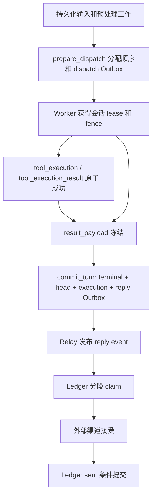

# 在途任务接管与幂等投递 — 设计文档

## 数据层权威与事务边界

下表逐字段来自当前迁移，包含默认值、空值和表内约束；唯一键、外键和索引随表列出。DDL 原文位于 REFERENCE-IMPLEMENTATION，直观阅读优先使用这些表格。

官方 SDK `session_events` 保存聊天转写，`app_name=tenant_id + "/" + agent_app_id`，配合 user_id/session_id。平台 `session_head/session_commit` 保存顺序、fence、终态和 Outbox 协调。SDK 同步持久化与平台 terminal 事务是两个边界：平台 Rollback 不撤销已写的 SDK 事件，故障重跑可留下重复输入或孤立工具调用痕迹；不能把“一个 terminal commit”写成“所有聊天事件一次且全原子”。

状态表都带 tenant；有意复用基础设施不会改变租户作用域。payload/result/tool result 使用租户密钥版本，解密及摘要校验失败拒绝恢复。

## 事务职责图



工具业务效果、工具结果事务、SDK 会话事件、冻结最终结果、terminal/Outbox 和外部发送分别存在独立故障窗口。图上不能把所有箭头解释为一个数据库事务。

### `preprocess_job`

| 字段 | 类型、默认值与空值约束 | 直观用途 |
|---|---|---|
| `tenant_id` | `text NOT NULL` | 租户强制边界 |
| `request_id` | `text NOT NULL` | 内部原始输入身份 |
| `job_id` | `text NOT NULL` | 预处理工作身份；与租户一起构成主键 |
| `tenant_version` | `bigint NOT NULL` | 受理时固定的租户配置版本 |
| `agent_app_id` | `text NOT NULL` | 租户内 agent 应用 |
| `session_id` | `text NOT NULL` | 原会话身份 |
| `user_id` | `text NOT NULL` | 租户作用域用户 |
| `channel` | `text NOT NULL` | 渠道类型 |
| `payload_ref` | `text NOT NULL` | 持久化内容引用 |
| `traceparent` | `text DEFAULT ''::text NOT NULL` | 跨异步边界传播的追踪上下文，不承载业务权限 |
| `state` | `text DEFAULT 'pending'::text NOT NULL` | 本层状态；与其他表状态不能混用 |
| `attempt` | `integer DEFAULT 0 NOT NULL` | 领取/发送尝试次数 |
| `lease_owner` | `text` | 当前工具/job owner |
| `lease_until` | `timestamp with time zone` | owner 到期时间（数据库时间） |
| `not_before` | `timestamp with time zone DEFAULT now() NOT NULL` | 允许下一次处理时间 |
| `reject_reason` | `text DEFAULT ''::text NOT NULL` | 预处理拒绝原因，进入拒绝结果时记录 |
| `dispatched_at` | `timestamp with time zone` | 完成dispatch的时刻；为空表示仍需调度 |
| `version` | `bigint DEFAULT 0 NOT NULL` | 乐观并发版本 |
| `created_at` | `timestamp with time zone DEFAULT now() NOT NULL` | 创建审计时间 |
| `updated_at` | `timestamp with time zone DEFAULT now() NOT NULL` | 最近更新审计时间 |
| `prepared_payload_ref` | `text DEFAULT ''::text NOT NULL` | 预处理结果引用 |
| `channel_binding_id` | `text NOT NULL` | 冻结 Bot Binding |
| `config_version` | `bigint NOT NULL` | 绑定的配置版本 |

表内约束：

- `CONSTRAINT preprocess_job_attempt_check CHECK ((attempt >= 0))`
- `CONSTRAINT preprocess_job_check CHECK ((((lease_owner IS NULL) AND (lease_until IS NULL) AND (state <> 'running'::text)) OR ((lease_owner IS NOT NULL) AND (lease_until IS NOT NULL) AND (state = ANY (ARRAY['running'::text, 'ready'::text])))))`
- `CONSTRAINT preprocess_job_check1 CHECK (((dispatched_at IS NULL) OR (state = 'ready'::text)))`
- `CONSTRAINT preprocess_job_config_version_check CHECK ((config_version >= 1))`
- `CONSTRAINT preprocess_job_prepared_ref_complete CHECK ((((state <> 'ready'::text) AND (prepared_payload_ref = ''::text)) OR ((state = 'ready'::text) AND ((prepared_payload_ref = ''::text) OR (length(btrim(prepared_payload_ref)) > 0)))))`
- `CONSTRAINT preprocess_job_state_check CHECK ((state = ANY (ARRAY['pending'::text, 'running'::text, 'ready'::text, 'rejected'::text, 'retry_wait'::text])))`
- `CONSTRAINT preprocess_job_tenant_version_check CHECK ((tenant_version >= 1))`
- `CONSTRAINT preprocess_job_version_check CHECK ((version >= 0))`

主键/唯一键/外键见参考实现对应 DDL；主要约束：

- `ALTER TABLE ONLY public.preprocess_job     ADD CONSTRAINT preprocess_job_pkey PRIMARY KEY (tenant_id, job_id);`
- `ALTER TABLE ONLY public.preprocess_job     ADD CONSTRAINT preprocess_job_tenant_id_request_id_key UNIQUE (tenant_id, request_id);`
- `ALTER TABLE ONLY public.preprocess_job     ADD CONSTRAINT preprocess_job_channel_binding_fk FOREIGN KEY (tenant_id, config_version, channel_binding_id) REFERENCES public.channel_binding(tenant_id, config_version, binding_id);`
- `ALTER TABLE ONLY public.preprocess_job     ADD CONSTRAINT preprocess_job_tenant_id_request_id_fkey FOREIGN KEY (tenant_id, request_id) REFERENCES public.inbox(tenant_id, request_id);`

索引：

- `CREATE INDEX preprocess_job_claim_idx ON public.preprocess_job USING btree (state, not_before, lease_until, created_at);`
- `CREATE INDEX preprocess_job_ready_idx ON public.preprocess_job USING btree (created_at) WHERE ((state = 'ready'::text) AND (dispatched_at IS NULL));`


### `execution_record`

| 字段 | 类型、默认值与空值约束 | 直观用途 |
|---|---|---|
| `tenant_id` | `text NOT NULL` | 租户强制边界 |
| `request_id` | `text NOT NULL` | 内部原始输入身份 |
| `tenant_version` | `bigint NOT NULL` | 受理时固定的租户配置版本 |
| `agent_app_id` | `text NOT NULL` | 租户内 agent 应用 |
| `agent_app_version` | `bigint NOT NULL` | 冻结应用元数据版本 |
| `agent_app_revision` | `bigint NOT NULL` | 冻结已发布应用修订 |
| `agent_content_digest` | `text NOT NULL` | 冻结应用内容SHA-256，防止版本内容漂移 |
| `config_version` | `bigint NOT NULL` | 绑定的配置版本 |
| `policy_version` | `bigint NOT NULL` | 治理策略版本 |
| `session_id` | `text NOT NULL` | 原会话身份 |
| `user_id` | `text NOT NULL` | 租户作用域用户 |
| `channel` | `text NOT NULL` | 渠道类型 |
| `input_seq` | `bigint NOT NULL` | 会话内输入顺序 |
| `payload_ref` | `text NOT NULL` | 持久化内容引用 |
| `traceparent` | `text` | 跨异步边界传播的追踪上下文，不承载业务权限 |
| `outcome` | `text DEFAULT 'queued'::text NOT NULL` | 业务执行结果 |
| `result_ref` | `text` | 已冻结结果引用 |
| `park_attempt` | `integer DEFAULT 0 NOT NULL` | 输入停放次数 |
| `model_call_count` | `integer DEFAULT 0 NOT NULL` | 逻辑模型调用数 |
| `not_before` | `timestamp with time zone` | 允许下一次处理时间 |
| `version` | `bigint DEFAULT 0 NOT NULL` | 乐观并发版本 |
| `created_at` | `timestamp with time zone DEFAULT now() NOT NULL` | 创建审计时间 |
| `park_deadline` | `timestamp with time zone` | 停放截止 |
| `blocked_at` | `timestamp with time zone` | 输入无法继续推进的持久阻塞时刻 |
| `blocked_reason` | `text` | 阻塞原因 |
| `cancel_requested_at` | `timestamp with time zone` | 取消请求时刻 |
| `cancel_version` | `bigint DEFAULT 0 NOT NULL` | 取消意图单调版本，0表示无取消 |
| `model_request_count` | `bigint NOT NULL DEFAULT 0 CHECK >=0` | 模型 HTTP transport 尝试计数（000004 增量）。 |

表内约束：

- `CONSTRAINT execution_record_agent_content_digest_check CHECK ((agent_content_digest ~ '^[0-9a-f]{64}$'::text))`
- `CONSTRAINT execution_record_cancel_intent_check CHECK (((cancel_version >= 0) AND (((cancel_requested_at IS NULL) AND (cancel_version = 0)) OR ((cancel_requested_at IS NOT NULL) AND (cancel_version >= 1)))))`
- `CONSTRAINT execution_record_input_seq_check CHECK ((input_seq >= 1))`
- `CONSTRAINT execution_record_outcome_check CHECK ((outcome = ANY (ARRAY['queued'::text, 'running'::text, 'pending'::text, 'blocked'::text, 'waiting_confirmation'::text, 'succeeded'::text, 'denied'::text, 'failed'::text, 'cancelled'::text, 'confirmation_denied'::text, 'confirmation_timeout'::text])))`
- `CONSTRAINT execution_record_park_attempt_check CHECK ((park_attempt >= 0))`
- `CONSTRAINT execution_record_model_call_count_check CHECK ((model_call_count >= 0))`
- `CONSTRAINT execution_record_park_state_check CHECK (((park_attempt >= 0) AND ((park_deadline IS NULL) OR (not_before IS NULL) OR (not_before <= park_deadline)) AND ((outcome <> 'blocked'::text) OR ((blocked_at IS NOT NULL) AND (blocked_reason = ANY (ARRAY['park_attempts_exhausted'::text, 'park_deadline_exceeded'::text]))))))`
- `CONSTRAINT execution_record_version_check CHECK ((version >= 0))`

主键/唯一键/外键见参考实现对应 DDL；主要约束：

- `ALTER TABLE ONLY public.execution_record     ADD CONSTRAINT execution_record_pkey PRIMARY KEY (tenant_id, request_id);`
- `ALTER TABLE ONLY public.execution_record     ADD CONSTRAINT execution_record_tenant_id_agent_app_id_session_id_input_se_key UNIQUE (tenant_id, agent_app_id, session_id, input_seq);`
- `ALTER TABLE ONLY public.execution_record     ADD CONSTRAINT execution_record_tenant_id_agent_app_id_agent_app_revision_fkey FOREIGN KEY (tenant_id, agent_app_id, agent_app_revision) REFERENCES public.agent_app_revision(tenant_id, agent_app_id, revision);`
- `ALTER TABLE ONLY public.execution_record     ADD CONSTRAINT execution_record_tenant_id_config_version_fkey FOREIGN KEY (tenant_id, config_version) REFERENCES public.config_snapshot(tenant_id, config_version);`
- `ALTER TABLE ONLY public.execution_record     ADD CONSTRAINT execution_record_tenant_id_request_id_fkey FOREIGN KEY (tenant_id, request_id) REFERENCES public.inbox(tenant_id, request_id);`

索引：

- `CREATE INDEX execution_park_ready_idx ON public.execution_record USING btree (tenant_id, agent_app_id, session_id, input_seq, not_before) WHERE (outcome = 'pending'::text);`


### `execution_attempt`

| 字段 | 类型、默认值与空值约束 | 直观用途 |
|---|---|---|
| `tenant_id` | `text NOT NULL` | 租户强制边界 |
| `request_id` | `text NOT NULL` | 内部原始输入身份 |
| `attempt_no` | `bigint NOT NULL CHECK(attempt_no>0)` | Worker 独立尝试序号 |
| `worker_id` | `text NOT NULL CHECK(length(btrim(worker_id))>0)` | 进程作用域 Worker owner |
| `fence` | `bigint NOT NULL CHECK(fence>0)` | 本次执行 fencing token |
| `state` | `text NOT NULL CHECK(state IN ('running','completed','retryable','superseded'))` | 本层状态；与其他表状态不能混用 |
| `started_at` | `timestamptz NOT NULL DEFAULT now()` | 执行尝试开始时刻 |
| `finished_at` | `timestamptz` | 尝试结束时刻 |

表内约束：

- `CHECK((state='running' AND finished_at IS NULL) OR (state<>'running' AND finished_at IS NOT NULL))`
- `PRIMARY KEY(tenant_id,request_id,attempt_no)`
- `FOREIGN KEY(tenant_id,request_id) REFERENCES public.execution_record(tenant_id,request_id)`


### `outbox`

| 字段 | 类型、默认值与空值约束 | 直观用途 |
|---|---|---|
| `tenant_id` | `text NOT NULL` | 租户强制边界 |
| `outbox_id` | `text NOT NULL` | 该租户Outbox事件主键 |
| `kind` | `text NOT NULL` | Outbox 事件种类 |
| `aggregate_id` | `text NOT NULL` | 关联业务聚合 |
| `event_seq` | `bigint NOT NULL` | 事件顺序 |
| `idempotency_key` | `text NOT NULL` | 稳定恢复/业务幂等键 |
| `payload_ref` | `text NOT NULL` | 持久化内容引用 |
| `traceparent` | `text` | 跨异步边界传播的追踪上下文，不承载业务权限 |
| `state` | `text DEFAULT 'pending'::text NOT NULL` | 本层状态；与其他表状态不能混用 |
| `version` | `bigint DEFAULT 0 NOT NULL` | 乐观并发版本 |
| `attempt` | `integer DEFAULT 0 NOT NULL` | 领取/发送尝试次数 |
| `next_attempt_at` | `timestamp with time zone DEFAULT now() NOT NULL` | 下一调度时刻 |
| `claim_owner` | `text` | 当前发布/发送 owner |
| `claim_until` | `timestamp with time zone` | claim 到期时间 |
| `published_at` | `timestamp with time zone` | 发布完成时刻 |
| `created_at` | `timestamp with time zone DEFAULT now() NOT NULL` | 创建审计时间 |

表内约束：

- `CONSTRAINT outbox_attempt_check CHECK ((attempt >= 0))`
- `CONSTRAINT outbox_event_seq_check CHECK ((event_seq >= 0))`
- `CONSTRAINT outbox_kind_check CHECK ((kind = ANY (ARRAY['audit'::text, 'tenant-control'::text, 'config-invalidation'::text, 'dispatch'::text, 'reply'::text, 'wakeup'::text, 'execution-control'::text])))`
- `CONSTRAINT outbox_state_check CHECK ((state = ANY (ARRAY['pending'::text, 'claimed'::text, 'retry_wait'::text, 'published'::text, 'dead_letter'::text])))`
- `CONSTRAINT outbox_version_check CHECK ((version >= 0))`

主键/唯一键/外键见参考实现对应 DDL；主要约束：

- `ALTER TABLE ONLY public.outbox     ADD CONSTRAINT outbox_pkey PRIMARY KEY (tenant_id, outbox_id);`
- `ALTER TABLE ONLY public.outbox     ADD CONSTRAINT outbox_tenant_id_kind_idempotency_key_key UNIQUE (tenant_id, kind, idempotency_key);`

索引：

- `CREATE INDEX outbox_claim_idx ON public.outbox USING btree (kind, state, next_attempt_at, created_at);`


### `delivery_ledger`

| 字段 | 类型、默认值与空值约束 | 直观用途 |
|---|---|---|
| `tenant_id` | `text NOT NULL` | 租户强制边界 |
| `delivery_key` | `text NOT NULL` | 原回复的稳定幂等身份 |
| `segment_no` | `integer NOT NULL` | 从零开始的回复片段 |
| `provider_message_id` | `text` | 渠道接受/交付消息标识 |
| `state` | `text NOT NULL` | 本层状态；与其他表状态不能混用 |
| `version` | `bigint DEFAULT 1 NOT NULL` | 乐观并发版本 |
| `updated_at` | `timestamp with time zone DEFAULT now() NOT NULL` | 最近更新审计时间 |
| `renderer_version` | `text DEFAULT 'legacy-v1'::text NOT NULL` | 冻结渲染规则版本 |
| `format_version` | `text DEFAULT 'legacy-v1'::text NOT NULL` | 冻结内容格式版本 |
| `content_digest` | `text DEFAULT repeat('0'::text, 64) NOT NULL` | 内容 SHA-256 校验 |
| `segment_count` | `integer DEFAULT 1 NOT NULL` | 该答案的分段总数 |
| `attempt` | `integer DEFAULT 0 NOT NULL` | 领取/发送尝试次数 |
| `not_before` | `timestamp with time zone DEFAULT now() NOT NULL` | 允许下一次处理时间 |
| `last_error_class` | `text` | 脱敏错误分类 |
| `client_request_id` | `text NOT NULL` | 每片段稳定渠道请求键 |
| `claim_owner` | `text` | 当前发布/发送 owner |
| `claim_until` | `timestamp with time zone` | claim 到期时间 |
| `reconcile_attempt` | `integer DEFAULT 0 NOT NULL` | 自动核对次数 |

表内约束：

- `CONSTRAINT delivery_ledger_attempt_check CHECK ((attempt >= 0))`
- `CONSTRAINT delivery_ledger_claim_check CHECK ((((state = 'sending'::text) AND (claim_owner IS NOT NULL) AND (length(btrim(claim_owner)) > 0) AND (claim_until IS NOT NULL)) OR ((state <> 'sending'::text) AND (claim_owner IS NULL) AND (claim_until IS NULL))))`
- `CONSTRAINT delivery_ledger_client_request_id_check CHECK ((length(btrim(client_request_id)) > 0))`
- `CONSTRAINT delivery_ledger_content_digest_check CHECK ((content_digest ~ '^[0-9a-f]{64}$'::text))`
- `CONSTRAINT delivery_ledger_format_version_check CHECK ((length(btrim(format_version)) > 0))`
- `CONSTRAINT delivery_ledger_reconcile_attempt_check CHECK ((reconcile_attempt >= 0))`
- `CONSTRAINT delivery_ledger_renderer_version_check CHECK ((length(btrim(renderer_version)) > 0))`
- `CONSTRAINT delivery_ledger_segment_count_check CHECK (((segment_count >= 1) AND (segment_no < segment_count)))`
- `CONSTRAINT delivery_ledger_segment_no_check CHECK ((segment_no >= 0))`
- `CONSTRAINT delivery_ledger_state_check CHECK ((state = ANY (ARRAY['pending'::text, 'sending'::text, 'sent'::text, 'ambiguous'::text, 'retry_wait'::text, 'failed'::text])))`
- `CONSTRAINT delivery_ledger_version_check CHECK ((version >= 1))`

主键/唯一键/外键见参考实现对应 DDL；主要约束：

- `ALTER TABLE ONLY public.delivery_ledger     ADD CONSTRAINT delivery_ledger_pkey PRIMARY KEY (tenant_id, delivery_key, segment_no);`

索引：

- `CREATE INDEX delivery_ledger_claim_expiry_idx ON public.delivery_ledger USING btree (claim_until) WHERE (state = 'sending'::text);`
- `CREATE INDEX delivery_ledger_retry_idx ON public.delivery_ledger USING btree (state, not_before, updated_at) WHERE (state = ANY (ARRAY['pending'::text, 'retry_wait'::text, 'ambiguous'::text]));`


### `delivery_resolution`

| 字段 | 类型、默认值与空值约束 | 直观用途 |
|---|---|---|
| `tenant_id` | `text NOT NULL` | 租户强制边界 |
| `delivery_key` | `text NOT NULL` | 原回复的稳定幂等身份 |
| `segment_no` | `integer NOT NULL CHECK (segment_no >= 0)` | 从零开始的回复片段 |
| `expected_version` | `bigint NOT NULL CHECK (expected_version >= 1)` | 处置前 Ledger 版本 |
| `actor` | `text NOT NULL CHECK (length(btrim(actor)) BETWEEN 1 AND 256)` | 管理调用方声明的处置人 |
| `evidence_ref` | `text NOT NULL CHECK (length(btrim(evidence_ref)) BETWEEN 1 AND 1024)` | 外部核实证据引用 |
| `decision` | `text NOT NULL CHECK (decision IN ('delivered', 'not_delivered', 'retry_not_delivered'))` | delivered/not_delivered/retry_not_delivered |
| `provider_message_id` | `text` | 渠道接受/交付消息标识 |
| `created_at` | `timestamptz NOT NULL DEFAULT now()` | 创建审计时间 |

表内约束：

- `PRIMARY KEY (tenant_id,delivery_key,segment_no,expected_version)`
- `FOREIGN KEY (tenant_id,delivery_key,segment_no)         REFERENCES public.delivery_ledger(tenant_id,delivery_key,segment_no)`
- `CHECK ((decision='delivered' AND provider_message_id IS NOT NULL AND length(btrim(provider_message_id)) > 0)         OR (decision IN ('not_delivered', 'retry_not_delivered') AND provider_message_id IS NULL))`


### `prepared_payload`

| 字段 | 类型、默认值与空值约束 | 直观用途 |
|---|---|---|
| `tenant_id` | `text NOT NULL` | 租户强制边界 |
| `request_id` | `text NOT NULL` | 内部原始输入身份 |
| `payload_ref` | `text NOT NULL` | 持久化内容引用 |
| `source_payload_ref` | `text NOT NULL` | 预处理前原始输入引用 |
| `payload_ciphertext` | `bytea NOT NULL` | 加密输入/预处理内容，AAD绑定租户和请求 |
| `payload_nonce` | `bytea NOT NULL` | 该内容加密nonce，解密必须匹配 |
| `content_digest` | `text NOT NULL` | 内容 SHA-256 校验 |
| `key_version` | `bigint NOT NULL` | 租户密钥版本 |
| `created_at` | `timestamp with time zone DEFAULT now() NOT NULL` | 创建审计时间 |
| `artifact_retention_seconds` | `bigint DEFAULT 0 NOT NULL` | 预处理附件保留时长，单位秒 |

表内约束：

- `CONSTRAINT prepared_payload_artifact_retention_seconds_check CHECK ((artifact_retention_seconds >= 0))`
- `CONSTRAINT prepared_payload_content_digest_check CHECK ((content_digest ~ '^[0-9a-f]{64}$'::text))`
- `CONSTRAINT prepared_payload_key_version_check CHECK ((key_version > 0))`

主键/唯一键/外键见参考实现对应 DDL；主要约束：

- `ALTER TABLE ONLY public.prepared_payload     ADD CONSTRAINT prepared_payload_pkey PRIMARY KEY (tenant_id, request_id);`
- `ALTER TABLE ONLY public.prepared_payload     ADD CONSTRAINT prepared_payload_tenant_id_payload_ref_key UNIQUE (tenant_id, payload_ref);`
- `ALTER TABLE ONLY public.prepared_payload     ADD CONSTRAINT prepared_payload_tenant_id_fkey FOREIGN KEY (tenant_id) REFERENCES public.tenant(tenant_id);`
- `ALTER TABLE ONLY public.prepared_payload     ADD CONSTRAINT prepared_payload_tenant_id_request_id_fkey FOREIGN KEY (tenant_id, request_id) REFERENCES public.inbox(tenant_id, request_id);`


### `tool_execution`

| 字段 | 类型、默认值与空值约束 | 直观用途 |
|---|---|---|
| `tenant_id` | `text NOT NULL` | 租户强制边界 |
| `request_id` | `text NOT NULL` | 内部原始输入身份 |
| `tool_call_id` | `text NOT NULL` | 稳定逻辑工具操作身份 |
| `tool_id` | `text NOT NULL` | 工具标识 |
| `tool_version` | `bigint NOT NULL` | 冻结工具版本 |
| `args_digest` | `text NOT NULL` | 规范化工具参数摘要 |
| `recovery_policy` | `text NOT NULL` | 工具恢复契约 |
| `idempotency_key` | `text NOT NULL` | 稳定恢复/业务幂等键 |
| `state` | `text NOT NULL` | 本层状态；与其他表状态不能混用 |
| `attempt` | `integer NOT NULL DEFAULT 0` | 领取/发送尝试次数 |
| `fence` | `bigint NOT NULL DEFAULT 0` | 本次执行 fencing token |
| `lease_owner` | `text` | 当前工具/job owner |
| `lease_until` | `timestamp with time zone` | owner 到期时间（数据库时间） |
| `external_handle` | `text` | 外部查询把手（可选） |
| `result_ref` | `text` | 已冻结结果引用 |
| `last_error` | `text` | 工具恢复错误摘要 |
| `created_at` | `timestamp with time zone NOT NULL DEFAULT now()` | 创建审计时间 |
| `updated_at` | `timestamp with time zone NOT NULL DEFAULT now()` | 最近更新审计时间 |

表内约束：

- `PRIMARY KEY (tenant_id, request_id, tool_call_id)`
- `CONSTRAINT tool_execution_policy_check CHECK (recovery_policy IN ('replay_safe','idempotent_key','queryable','manual'))`
- `CONSTRAINT tool_execution_state_check CHECK (state IN ('pending','running','succeeded','failed','effect_unknown'))`
- `CONSTRAINT tool_execution_attempt_check CHECK (attempt >= 0)`
- `CONSTRAINT tool_execution_fence_check CHECK (fence >= 0)`
- `CONSTRAINT tool_execution_lease_check CHECK ((state = 'running' AND lease_owner IS NOT NULL AND lease_until IS NOT NULL) OR (state <> 'running'))`
- `CONSTRAINT tool_execution_idempotency_key_check CHECK (length(btrim(idempotency_key)) > 0)`

索引：

- `CREATE INDEX tool_execution_reclaim_idx ON public.tool_execution (lease_until) WHERE state = 'running';`
- `CREATE UNIQUE INDEX tool_execution_idempotency_idx ON public.tool_execution (tenant_id, tool_id, tool_version, idempotency_key);`


### `tool_execution_result`

| 字段 | 类型、默认值与空值约束 | 直观用途 |
|---|---|---|
| `tenant_id` | `text NOT NULL` | 租户强制边界 |
| `request_id` | `text NOT NULL` | 内部原始输入身份 |
| `tool_call_id` | `text NOT NULL` | 稳定逻辑工具操作身份 |
| `result_ref` | `text NOT NULL` | 已冻结结果引用 |
| `content_digest` | `text NOT NULL CHECK(content_digest ~ '^[0-9a-f]{64}$')` | 内容 SHA-256 校验 |
| `ciphertext` | `bytea NOT NULL` | AES-GCM 密文 |
| `nonce` | `bytea NOT NULL CHECK(octet_length(nonce)=12)` | AES-GCM nonce（12 字节） |
| `key_version` | `bigint NOT NULL CHECK(key_version>0)` | 租户密钥版本 |
| `created_at` | `timestamptz NOT NULL DEFAULT now()` | 创建审计时间 |

表内约束：

- `PRIMARY KEY(tenant_id,request_id,tool_call_id)`
- `FOREIGN KEY(tenant_id,request_id,tool_call_id) REFERENCES public.tool_execution(tenant_id,request_id,tool_call_id)`


### `tool_attempt`

| 字段 | 类型、默认值与空值约束 | 直观用途 |
|---|---|---|
| `tenant_id` | `text NOT NULL` | 租户强制边界 |
| `grant_id` | `text NOT NULL` | 一次性确认授权 |
| `request_id` | `text NOT NULL` | 内部原始输入身份 |
| `tool_call_id` | `text NOT NULL` | 稳定逻辑工具操作身份 |
| `state` | `text NOT NULL` | 本层状态；与其他表状态不能混用 |
| `result_ref` | `text` | 已冻结结果引用 |
| `created_at` | `timestamp with time zone DEFAULT now() NOT NULL` | 创建审计时间 |
| `updated_at` | `timestamp with time zone DEFAULT now() NOT NULL` | 最近更新审计时间 |

表内约束：

- `CONSTRAINT tool_attempt_state_check CHECK ((state = ANY (ARRAY['effect_unknown'::text, 'succeeded'::text, 'failed'::text])))`

主键/唯一键/外键见参考实现对应 DDL；主要约束：

- `ALTER TABLE ONLY public.tool_attempt     ADD CONSTRAINT tool_attempt_pkey PRIMARY KEY (tenant_id, grant_id);`
- `ALTER TABLE ONLY public.tool_attempt     ADD CONSTRAINT tool_attempt_tenant_id_request_id_tool_call_id_key UNIQUE (tenant_id, request_id, tool_call_id);`
- `ALTER TABLE ONLY public.tool_attempt     ADD CONSTRAINT tool_attempt_tenant_id_grant_id_fkey FOREIGN KEY (tenant_id, grant_id) REFERENCES public.confirmation_grant(tenant_id, grant_id);`


### `tool_result_payload`

| 字段 | 类型、默认值与空值约束 | 直观用途 |
|---|---|---|
| `tenant_id` | `text NOT NULL` | 租户强制边界 |
| `grant_id` | `text NOT NULL` | 一次性确认授权 |
| `request_id` | `text NOT NULL` | 内部原始输入身份 |
| `result_ref` | `text NOT NULL` | 已冻结结果引用 |
| `result_ciphertext` | `bytea NOT NULL` | 加密最终/工具结果内容 |
| `result_nonce` | `bytea NOT NULL` | 结果加密nonce，不能跨结果复用 |
| `content_digest` | `text NOT NULL` | 内容 SHA-256 校验 |
| `key_version` | `bigint NOT NULL` | 租户密钥版本 |
| `created_at` | `timestamp with time zone DEFAULT now() NOT NULL` | 创建审计时间 |

表内约束：

- `CONSTRAINT tool_result_payload_content_digest_check CHECK ((content_digest ~ '^[0-9a-f]{64}$'::text))`
- `CONSTRAINT tool_result_payload_key_version_check CHECK ((key_version >= 1))`

主键/唯一键/外键见参考实现对应 DDL；主要约束：

- `ALTER TABLE ONLY public.tool_result_payload     ADD CONSTRAINT tool_result_payload_pkey PRIMARY KEY (tenant_id, grant_id);`
- `ALTER TABLE ONLY public.tool_result_payload     ADD CONSTRAINT tool_result_payload_tenant_id_result_ref_key UNIQUE (tenant_id, result_ref);`
- `ALTER TABLE ONLY public.tool_result_payload     ADD CONSTRAINT tool_result_payload_tenant_id_grant_id_fkey FOREIGN KEY (tenant_id, grant_id) REFERENCES public.tool_attempt(tenant_id, grant_id);`
- `ALTER TABLE ONLY public.tool_result_payload     ADD CONSTRAINT tool_result_payload_tenant_id_request_id_fkey FOREIGN KEY (tenant_id, request_id) REFERENCES public.execution_record(tenant_id, request_id);`


### `local_note`

| 字段 | 类型、默认值与空值约束 | 直观用途 |
|---|---|---|
| `tenant_id` | `text NOT NULL` | 租户强制边界 |
| `business_key` | `text NOT NULL` | 笔记业务幂等键 |
| `request_id` | `text NOT NULL` | 内部原始输入身份 |
| `note_id` | `text NOT NULL` | 真实业务记录身份 |
| `args_digest` | `text NOT NULL CHECK(args_digest ~ '^[0-9a-f]{64}$')` | 规范化工具参数摘要 |
| `ciphertext` | `bytea NOT NULL` | AES-GCM 密文 |
| `nonce` | `bytea NOT NULL CHECK(octet_length(nonce)=12)` | AES-GCM nonce（12 字节） |
| `key_version` | `bigint NOT NULL CHECK(key_version>0)` | 租户密钥版本 |
| `created_at` | `timestamptz NOT NULL DEFAULT now()` | 创建审计时间 |

表内约束：

- `PRIMARY KEY(tenant_id,business_key)`
- `UNIQUE(tenant_id,note_id)`


## 其他关联表

Inbox、session_head、session_commit、inbound_payload、result_payload 与 SDK session_events 的逐字段表格见 [会话数据模型](../conversation-continuity/design.md)。本篇参考实现包含两组 DDL，用于从零构建恢复关系。

## 状态机与恢复动作

| 状态层 | 主要状态 | 恢复判定 |
|---|---|---|
| Inbox | preprocess_pending / dispatch_pending / dispatch_ready / terminal | 相同渠道消息返回同一持久请求；输入摘要碰撞拒绝。 |
| execution_record | running、停放/阻塞元数据、业务 outcome | input_seq 未就绪时 ParkInput/Wakeup；不能把正常返回等同成功答案。 |
| execution_attempt | running → completed / retryable；旧 running → superseded | 尝试日志通过 request 行锁排序，旧 fence 不能覆盖新尝试。 |
| Outbox | pending → claimed → published | 过期 claimed 可重领；发送后、标记前崩溃可能重复发布。 |
| 工具执行 | running → succeeded / failed / effect_unknown | Claim 仅允许 pending/effect_unknown/过期 running；成功结果复用。 |
| Ledger | pending/retry_wait → sending → sent；不确定 → ambiguous | expired sending 先记 owner_lost，不直接证明未发送；核对耗尽 → failed。 |

Ledger 的 sent/failed 视为发送流程终态，但只有 failed/reconcile_exhausted 允许有证据的人工异常处置。sent 不允许被重新打开。

## 并发、错误与竞态

| 竞争/故障 | 强制点 | 结果 |
|---|---|---|
| 重复 callback / 队列事件 | Inbox 外部消息唯一键、Outbox 幂等键 | 保持 request/input_seq，不创建第二次业务输入。 |
| 旧 Worker 迟到提交 | session version、input_seq、fence | stale fence → ErrStaleFence；版本冲突 → ErrVersionConflict；唯一提交冲突 → ErrCommitConflict。 |
| Redis fence 计数落后 PG | EnsureFenceAtLeast | 下次 Acquire 递增到持久 last_fence 之后；不是 Redis 数据丢失的完整容灾方案。 |
| 旧工具 owner 写结果 | owner+fence+lease_until>now() | Complete 拒绝并回滚密文插入；外部已生效仍靠业务协议。 |
| 两 sender / 两管理员 | Ledger claim/version 与 expected_version | 一个有效状态迁移，另一个冲突；不能绕过 claim 直接发送。 |
| SDK 事件已写、terminal 未提交 | frozen result 或原输入恢复 | 不回滚 SDK；存在冻结结果时复用，避免再生成另一个答案。 |
| 下游结果未知 | ambiguous/reconcile_exhausted | 不盲重发；保留异常与证据处置。 |

租户密钥投影、Binding 路由、SDK TenantKey/checked facade、SQL tenant 条件和冻结 ReplyRoute 是不同强制点；模型自报租户不能代替它们。

## 工具恢复的执行顺序

1. `GuardedCallable.callDurable` 校验租户执行上下文、payload key version、规范化参数及工具版本。普通 allow 的 operation ID 是 tenant/request/tool/version/参数摘要的 SHA-256；同一输入的同工具同参数视为同一逻辑操作。需要不同效果时必须带不同业务参数/键。ask 使用确认中的持久化调用 ID。
2. 读取 tool_execution。已 succeeded 且不可变字段一致时，LoadResult 解密并校验摘要，直接复用；failed 拒绝继续。未知新工具默认 manual。
3. Claim 首次创建 running，或领取 pending/effect_unknown/过期 running；attempt 和工具 fence 增加。未过期 running 不可抢占。
4. 启动工具续租。ask 消费 grant；遇到已消费冲突时仅允许恢复同 request/tool-call 且 effect_unknown 的 attempt，不再次消费授权。
5. 恢复时 queryable 先查询；completed=false 必须证明外部操作未被接受，pending/unknown 必须返回错误。idempotent_key 同键调用；replay_safe 重放；manual 再次尝试收敛为 effect_unknown，任务可终结为 tool_effect_unknown。
6. 外部调用错误可将 tool_execution 标为 effect_unknown；lease 丢失立即取消 call context。外部系统若不响应取消，仍由其幂等/查询协议避免重复业务效果。
7. 成功后停止续租，Complete 在同一 PostgreSQL 事务中验证 owner/fence/未过期租期、把执行置 succeeded 并写入 AES-GCM 加密的 tool_execution_result。任何一步失败均回滚。
8. ask 再把结果镜像至 tool_result_payload 并完成 tool_attempt；镜像前故障可从 tool_execution_result 重建。业务效果与平台结果是两个事务；local_note 用 (tenant_id,business_key) 唯一键覆盖这段窗口。

恢复的是已保存结果或外部操作的协议状态，不会恢复工具函数体的内存/指令位置。未冻结最终结果时模型可能重新推理；相同逻辑操作重新进入 GuardedCallable 时复用或安全恢复。任意 Graph 检查点也不能据此推断为自动恢复整张图的执行栈。

## 工具策略与权限

allow/ask 是授权策略，replay_safe/idempotent_key/queryable/manual 是恢复策略，二者正交。普通允许调用也要持久化；确认工具只是增加一次性 grant 和结果镜像。生产组合根注入 execution store 与 payload key resolver，缺少 durable result 能力拒绝降级。旧 nil Store 的独立接口不提供分布式保证。

内部保证与外部交付分别判定：同一输入只有一个有效 terminal commit；每个回复 segment 在 Ledger 中只有一行权威状态，`sent` 后自动路径只跳过发送。该行唯一不等于渠道只接收一次。下游已接受、本地确认未提交的 P4 窗口需要下游可靠去重或查询才能自动收敛。当前 WeCom 没有请求键查询适配器，内容级有限时间去重不足以提供永久请求级幂等；取消、HTTP 5xx 和响应丢失均可能留下不确定结果。系统不盲目补发，先保留 `ambiguous`；核对次数耗尽可转为 `failed/reconcile_exhausted`，仍需运维查证。

## 实体关系与唯一性的层级

| 逻辑对象 | 身份 | 可有多少次尝试 |
|---|---|---|
| 原渠道输入 | tenant/channel/account/external_message_id | 渠道可重传，平台request应保持一致。 |
| 内部任务 | tenant/request_id | 多次execution_attempt。 |
| 会话轮次 | tenant/app/session/input_seq | 只有一个有效terminal。 |
| 普通工具操作 | tenant/request/工具版本/规范参数摘要派生ID | 多次tool_execution.attempt。 |
| 确认工具调用 | tenant/request/持久tool_call_id与grant | grant消费一次，安全恢复可多次领取。 |
| 最终回复 | 稳定reply ID/DeliveryKey | 多次Outbox发布或queue重投。 |
| 回复segment | tenant/delivery_key/segment_no | 多次发送/核对尝试，单行权威状态。 |
| 笔记业务效果 | tenant/business_key | 幂等重试复用同一笔记。 |

这里没有一个“全系统万能幂等键”。每个层级有自己的重复来源和语义，正确性依赖它们能通过tenant/request和固定坐标关联。

## 哪些写在同一事务，哪些不是

```text
事务A：工具succeeded + tool_execution_result密文
事务B：ask结果镜像/确认账本推进（另有自己的存储步骤）
事务C：最终result_payload冻结
事务D：terminal commit + session/execution推进 + reply Outbox
事务E：Ledger发送确认
事务F：管理员Ledger处置 + 审计 + 必要Outbox重调度

外部业务效果、SDK事件、provider接受不是以上全部事务的成员
```

事务B不是事务A的组成部分，A提交后B未完成可以从A结果恢复。外部笔记业务写入也先于A，因此local_note必须按业务键自身幂等。事务C先于D，所以要有冻结答案续提交分支。E在外部接受之后，所以无法消除P4。

## tool_execution的状态不等于工具函数进度

running表示某个owner拥有租期并正在推进，不能精确证明它已发出外部请求。succeeded加可解密结果表示平台已保存成功输出。effect_unknown表示没有可信结果证明外部状态，需要策略处理；failed也不是所有外部副作用已被撤销。

lease_owner、lease_until、fence回答“谁能写平台结果”，external_handle或idempotency_key回答“如何关联外部操作”。args_digest只提供一致性校验，不能替代原参数内容。

## 成功结果的加密绑定

tool_execution_result保存nonce、key_version、content_digest与结果密文，LoadResult要求对应execution处于succeeded且result_ref一致，再用租户密钥及AAD解密并核对摘要。

错误tenant、错误request/call坐标、错误key version或内容篡改都应导致读取失败。把一份密文复制到别的逻辑调用名下不会形成可用恢复结果；不能用“有一行结果”跳过这些校验。

## Ledger计划碰撞与状态冲突分别意味着什么

同DeliveryKey/segment但renderer、format、content digest或segment_count不同属于计划不一致，应拒绝。state/version/owner冲突则可能是另一个有效处理者已推进，需要重读状态。

如果把这两类都当普通网络重试，节点会持续重试永远不能匹配的内容，或者不安全地重发已完成段。日志与运维应保留冲突类别和原request关联，避免用删除Ledger消除报错。

## 新owner与旧owner结果竞争

新owner可能取得更高会话fence，但旧工具owner仍受工具lease约束；新工具claim要等待可领取。旧工具完成即便来不及被新模型看到，成功结果也成为可复用的durable事实。

同时，外部不响应取消的旧调用可能仍有业务效果。平台拒绝旧owner写结果并不等于外部效果不存在，idempotent_key/queryable正是处理这层区别；manual不能靠增加fence自动变安全。
