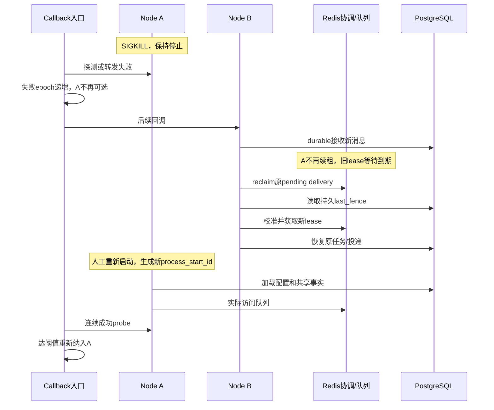

# 单主机多容器实例可用性 — 完整实现说明

## 拓扑为什么能接管

两个应用容器共享 PostgreSQL、Redis 和已发布技能内容。节点可看到同一 Inbox、session、execution、Outbox 和 Ledger，才有可能从故障实例的 durable 事实继续。若每实例使用独立业务数据库，只是两套环境。共享可写的临时目录也不能代替支持事务的状态后端。

WeCom 使用 HTTP callback。独立 wecom-ha-entry 固定公开 URL，节点端口仅用于观测；应用实例故障不会要求用户改地址。入口自身仍是单点，不由双应用节点获得冗余。

## 稳定入口的当前算法

`wecomHAEntry` 对每个后端并行执行有超时的 `/readyz` 探测。HTTP 200、响应有效且探测 context 未失效才算成功；探测 body 最多读取 1024 字节。每次探测记录开始时的 epoch，较新的失败会递增 epoch，旧结果因 epoch 不匹配被丢弃。

路由须满足健康且 `checked_at` 未过期。初次成功可立即纳入；探测/转发失败或健康过期后需连续成功次数达到阈值。健康有效期为 `3 × (ProbeInterval + ProbeTimeout)`。epoch 是进程内竞态控制字段，不在 /statusz 中公开。

`serveHTTP` 只为 callback 路径做转发。正文上限 2 MiB；按轮转起点选择有效健康节点，每次回调对每个节点最多一次。网络失败、502/503/504、非 4xx 的响应读取失败或超限会摘除该后端并尝试另一节点。4xx 拒绝不切换，4xx body 读取失败时仍返回该状态；客户端取消不据此惩罚后端。完整响应缓冲成功后才写给客户端。

`forward` 保留 RequestURI、正文和签名相关头，`copyHeaders` 去掉逐跳头及 Connection 指定的头，不新增 X-Forwarded-*，也不跟随重定向。入口重试靠后端 durable Inbox 去重；不能代替投递端的幂等协议。

| 配置 | 默认值 | 校验 / 行为 |
|---|---|---|
| TRPC_LISTEN_ADDRESS | :8080 | 非空，无首尾空白。 |
| TRPC_WECOM_HA_ENTRY_BACKENDS | 必填 | 至少两个不同 http origin；拒绝 user/query/fragment/path，含尾斜杠路径也拒绝。 |
| TRPC_WECOM_HA_ENTRY_PROBE_INTERVAL | 1s | 100ms–1m。 |
| TRPC_WECOM_HA_ENTRY_PROBE_TIMEOUT | 1s | 100ms–30s。 |
| TRPC_WECOM_HA_ENTRY_REQUEST_TIMEOUT | 2s | 100ms–30s，每后端一次转发。 |
| TRPC_WECOM_HA_ENTRY_RECOVERY_SUCCESSES | 2 | 1–10，仅恢复阶段要求连续成功。 |
| HealthTTL | 派生值 | 3×(interval+probe timeout)，没有单独环境变量。 |

## live、ready 与状态的分工

节点 /livez 表示 HTTP 进程存活；/readyz 检查共享依赖与运行时组件，组件必须至少成功完成实际轮询，空闲轮询也计成功。Delivery Supervisor 必须观察账号消费者访问队列成功，创建 goroutine 不算就绪。长模型请求不直接作为组件故障；该机制不是任意线程死锁探测器。/statusz 的 components_ready 不代替 /readyz 的实时依赖检查。

入口 /livez 表示入口存活；/readyz 要求至少一个有效健康后端；/statusz 是健康快照，不是任务完成证据。

## 身份、文件与重新加入

每个实例有固定 instance_id，启动时新生成 process_start_id，角色 owner 含二者。重新加入必须获得新启动身份，以普通竞争者参与 lease/claim，不复用旧 owner，也不主动抢占未过期工作。

四个多实例应用服务使用 read_only 根文件系统、独立 256MiB /tmp tmpfs、只读共享技能卷。bootstrap 是技能写入者；读节点只校验，缺包/内容不符即失败。ensureSkillFile 在摘要根之外创建临时文件、写入同步后原子 link；已发布内容不可覆盖。密钥投影在各自 /tmp，不共享可写工作目录。

## SIGTERM 排空顺序

`signalCtx` 接收 SIGTERM/父 context 取消；活动工作使用独立 `processCtx`。主运行时先 `health.beginDrain()`，再 `drainGate.Begin()`，同时调用 HTTP Shutdown 并等待参与排空的角色退出。业务 HTTP 在排空期间返回 503，live/ready/status 路径可检查；ready 不会被迟到的成功轮询恢复成 true。

Worker、Delivery 和 Wakeup 的读取 context 先取消，活动工作 context 保留。预处理和 Relay 通过 drainPoll 停止下一批；Delivery Supervisor 停止 refresh/新建消费者，runUntilDrained 不重启已排空的消费者。活动进度发布在最终 processCtx 取消时退出。

默认排空 30 秒；Worker/Delivery 的局部超时装配为应用时限加 1 秒，让主运行时先控制全局期限。正常结束后取消 processCtx；超时则报告排空超时、取消工作并退出。未完成的 durable 工作留给存活节点。排空不是共享队列清零，也不会人工删除 lease。SIGKILL 完全跳过本流程。

## SIGKILL、重加入与反向故障

SIGKILL 后 readiness 转发失败/探测失败先摘除入口；业务工作等 lease/claim 到期后由 pending reclaim 与持久扫描接管。故障实例须保持停止，才可归因于存活节点。重新启动故障实例属于新阶段，不能拿重启结果证明此前自动接管。

重新加入后等待预设稳定窗口，检查 process_start_id 变化、入口连续成功重新纳入、无持续抖动和旧任务重复回复。然后故障另一实例，区分当轮任务实际 owner，不能凭节点名推断受影响任务。

## 为什么不能只依赖容器重启

restart 成功只证明运行时能重建进程；原任务是否完成仍由 execution/commit/Ledger 和渠道证据判断。Compose restart:no 专用于接管演练。优雅停止、强杀、容器自动重建及共享依赖故障必须独立判定。

| 参数 | 当前本地组合根装配 | 意义 |
|---|---|---|
| Worker lease / renew | 30s / 10s | 失权取消执行；lease 到期才可换 owner。 |
| Worker reclaim / limit | 5s / 100 | 扫描 pending；不代表 5 秒内必完成恢复。 |
| Relay claim / renew / poll | 30s / 10s / 100ms | 先发布，再标记 published；发布后崩溃可重发同一事件。 |
| Delivery claim / renew | 30s / 10s | 每分段发送权。 |
| Delivery reclaim / limit | 5s / 100 | 回收账号回复队列 pending。 |
| Delivery retry | 初始 1s，最大 1m，最多 8 次 | 明确可重试错误的有界退避。 |
| Delivery reconcile | 最多 8 次 | 无查询能力或核对失败最终保留 failed/reconcile_exhausted 事件。 |
| 工具 lease / renew | 默认 30s / TTL÷3 | PostgreSQL 工具 lease，与会话 lease 是两套执行权。 |
| 应用排空 | 默认 30s，可配置 1s–5m | 停止新领取，保留已接纳工作，超时再取消。 |
| Compose 停止宽限 | 默认 45s | 必须比应用排空更长并留退出余量。 |

这些值是当前 `webui-local`/`wecom-local` 装配值，不能与 Consumer 未配置时的包级兜底值混用。恢复耗时还包含排队、上游延迟、退避和采样误差，不能把 TTL 相加写成已验证的 RTO。

内部保证与外部交付分别判定：同一输入只有一个有效 terminal commit；每个回复 segment 在 Ledger 中只有一行权威状态，`sent` 后自动路径只跳过发送。该行唯一不等于渠道只接收一次。下游已接受、本地确认未提交的 P4 窗口需要下游可靠去重或查询才能自动收敛。当前 WeCom 没有请求键查询适配器，内容级有限时间去重不足以提供永久请求级幂等；取消、HTTP 5xx 和响应丢失均可能留下不确定结果。系统不盲目补发，先保留 `ambiguous`；核对次数耗尽可转为 `failed/reconcile_exhausted`，仍需运维查证。

## 容量和可观测边界

单个存活实例必须承担预定两租户负载。输入速率持续大于处理速率会形成积压；模型恢复重试也增加上游请求。低流量生命周期脚本不证明峰值容量或长期连接稳定性。当前为 callback，没有 Bot 长连接踢出指标；应检查入口健康震荡、组件错误、pending/Outbox 积压、迟到回复和业务效果。

## 一次故障中的两条恢复时间线

入口恢复可以早于旧任务lease到期，后续新消息也可能等待原会话前序输入。此时“入口已经ready”和“所有任务已经恢复”是不同事实。测量时分别记录，不能用一次HTTP200代替整个业务恢复时延。

## 三种健康状态为何不能合并

| 状态 | 谁判定 | 能证明 | 不能证明 |
|---|---|---|---|
| 容器进程Running | 容器运行时 | 进程没有退出 | 依赖、Worker和发送可工作。 |
| 应用/readyz | 应用实时依赖与组件观察 | 该实例具备当前装配要求的服务条件 | 任意线程无死锁、所有旧任务已完成。 |
| 入口backend healthy | 入口probe与转发结果 | 最近有可信且未过期的成功观察 | 本轮原任务由该节点执行。 |

组件OnPoll允许空闲成功，避免低流量时无法进入ready；依赖的实时检查补足历史观察。反过来，组件没有成功访问过队列前不能仅凭启动goroutine就ready。

## epoch如何解决迟到成功探测

以下是机制示例，数字仅说明顺序：

1. 对A开始probe，记录epoch=7。
2. callback转发到A发生失败，入口把A标为失败并递增为8。
3. 先前probe迟到返回200；recordProbe发现开始epoch7与当前8不同，丢弃。
4. 后续新probe按epoch8继续，只有满足恢复窗口才重新放行。

如果只保存atomic healthy布尔值，第3步会把刚失败的节点重新标为健康。锁保护状态快照，epoch保护时间顺序；两者都不是数据库任务fence。

## 健康过期解决“很久没探测却一直可用”

仅保存最后一次成功布尔值，会让探测循环阻塞或调度暂停后仍向过时后端转发。当前路由还检查checked_at与HealthTTL；超过期限即不可选。

后续probe恢复时，代码先识别旧观察过期、清零连续成功，再按恢复阈值累计。因此长时间没有观察后的一次成功不会绕过恢复稳定要求。初次启动从未失败的后端例外，首次成功即可纳入。

## 为什么探测和请求要分别限时

慢节点不应阻塞健康peer的探测，所以各后端probe并发执行。probeTimeout约束健康检查成本；requestTimeout约束一次真实callback转发，二者业务含义不同。

如果每个请求最多尝试两个后端，入口延迟可能包含两个尝试而不是单个requestTimeout。还存在读取原请求、响应处理和应用本身耗时，不能把默认2秒写成最终回复上限。用户答案经异步模型/工具和投递链路完成。

## 为什么要完整缓冲后端响应

一旦入口把部分响应写给客户端，再发现后端连接中断，就无法安全换一个后端重写同一个HTTP响应。当前限制响应体大小并先完整读入，成功后才写响应头和正文。

这改善callback入口的失败切换，不使下游主动发回复变成幂等。入口重试可能让应用收到同一callback多次，由Inbox去重；主动发送的P4仍由Ledger与渠道协议处理。

## 重新加入不应“拿回原来的任务”

新进程没有权利继承同槽位旧进程的未过期lease。否则N1重启会与已经接管的N2同时推进。新的process_start_id让consumer/owner可区分；业务记录仍指向原request，执行者由竞争协议选择。

如果N2正在处理某个会话，N1加入后等待或处理其他可领取工作。并不要求连接/任务立刻重新均分，也不因“原来是N1的任务”而主动抢占。

## 排空为何必须区分读取消与工作取消

收到SIGTERM时若直接取消唯一根context，正在发送的HTTP调用可能被立即中断，从一个可完成操作变成不确定投递。当前先取消读取，让已经进入的发送或工具工作继续。

排空截止后仍未完成，主运行时才取消工作。超时是有界退出的必要边界，不承诺能终止不响应context的外部效果。其记录仍受恢复契约保护，peer后续不能盲目重放。

## 文件只读与bootstrap写入的分工

原子发布保证读者看见完整文件或看不见文件；不会把正在写的内容计算成正式包摘要。发布临时文件放在摘要根之外，已有目标只接受完全相同内容，避免两个版本覆盖。

只读节点启动失败是配置/发布错误的明确信号。如果让每个节点启动时自动chmod、创建或覆盖共享包，重新加入会悄悄改变其他实例正在使用的内容，破坏不可变版本假设。

## 持续负载下如何理解三种退化

输入积压表示推进速率不足，应区分模型延迟、工具延迟、数据库竞争和发送退避。健康振荡表示入口或组件状态反复变化，应检查依赖和超时，不能只不断降低恢复阈值。重复回复则必须按原request和segment追踪，不能用“流量大”解释。

这些退化可能同时出现，但修复动作不同。单实例资源测试、反向故障和较长稳定窗口才有条件区分趋势；默认脚本的短观察窗口只覆盖生命周期基本路径。

## 用一组示意状态观察重新加入

初始A/B均健康。A故障后，entry的A失败计数增加、基础健康标记撤销，B仍有效。A重新启动的URL可以保持不变，但应用process_start_id不同；entry的backend槽位并不会因此自动算健康。

| 观察时刻 | A应用状态 | entry对A | 任务关系 |
|---|---|---|---|
| A停止期间 | 无进程 | 不健康/观察过期 | B按lease/claim继续。 |
| 新A启动 | starting | 尚未满足恢复窗口 | 不继承旧owner资格。 |
| 新A ready后首次成功probe | ready | 默认恢复阈值2，尚未重新纳入 | 可参与内部可领取工作。 |
| 连续第二次成功probe | ready | 重新纳入callback | 处理新回调，但不强抢B。 |
| 后续某probe失败 | 可能degraded或网络异常 | 再摘除并清连续成功 | 任务仍按各自租约裁决。 |

表中“第一次/第二次”指默认配置下故障后的连续成功，不是所有启动都固定要两次。初次从未失败后端可首个成功纳入。

## 反向故障为什么不能省略

只测N1退出可能掩盖N2配置更完整、N1缺凭据或某些角色只在N2装配的问题。反向故障要求重新确认N1已经就绪且拥有兼容配置，再关闭N2。

若上一轮靠人工改N2配置才恢复，之后反向成功也不能把第一轮改判通过。每轮固定版本与配置，修复后应重新开始基线，并保留失败轮证据。

## 常驻入口与共享依赖的生命周期

应用节点更新不应连带停止入口和数据库。对单个实例注入故障，使用确认过目标的单容器动作；整套compose down会关闭共享依赖，已经不再是单应用实例故障。

脚本结束时清理其独立测试项目是收尾动作，与故障期间自动接管不同。持久卷清理发生在验收结束后，不能用来修复运行中的幂等或租约状态。

## 本地临时状态为什么允许丢失

secret投影可由安全配置重新产生，临时文件可由相应工作重新创建；它们不应成为原输入、工具结果或待发回复唯一副本。只读root帮助暴露意外写入，私有tmpfs避免两个容器互相覆盖。

如果未来新增工具把长程进度只写/tmp，该工具仍没有跨节点进度恢复能力。容器隔离不会自动把该文件变成共享durable状态，必须另行设计业务持久化与恢复契约。

## 入口限时与下游超时如何区分

入口只处理接收callback，模型/工具通常在异步链路执行。callback返回快不等于最终答案快；入口2秒单次尝试也不应作为模型生成超时。

相反，主动发送回复时的HTTP超时发生在Delivery/provider链路，可能形成P4不确定。运维应从请求路径区分入口故障、模型失败和投递失败，而不是统一称“HTTP超时重试”。

## 单实例承载的资源推演

两个实例稳定时总吞吐满足需求，但故障后一个实例承担全部计划流量，还可能处理旧任务重试。CPU、内存、PG连接、Redis队列、模型并发额度和工具外部限制都可能成为瓶颈。

如果到达速率持续高于处理能力，积压不会因HA机制自动消失。应将容量结论限定为实际测试的并发、速率和窗口，观察最老未完成任务年龄是否恢复，而不是只数容器是否活着。

## 持续稳定应能给出的证据

健康快照需要时间序列：一次healthy无法说明没有振荡。积压需要输入和完成速率及年龄：一次count低无法说明没有长期饥饿。重复回复需要原消息和客户端关联：一次sent无法说明没有迟到重复。

因此生命周期脚本、代码竞态测试和真实业务负载分别提供不同证据，文档不会把其中任意一个扩大成全部稳定性保证。
