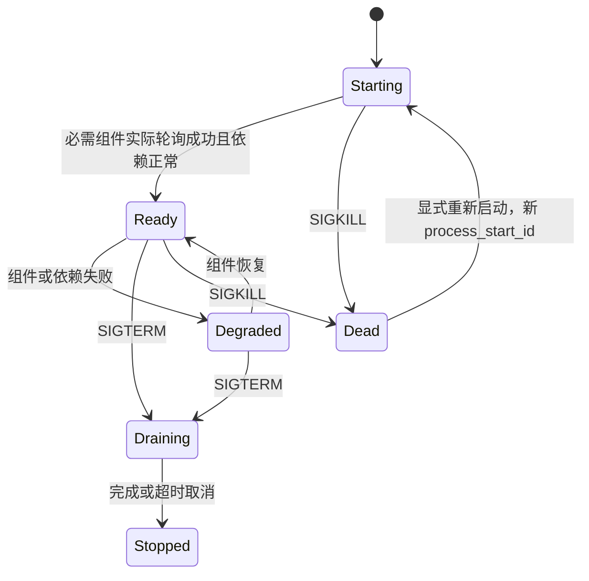
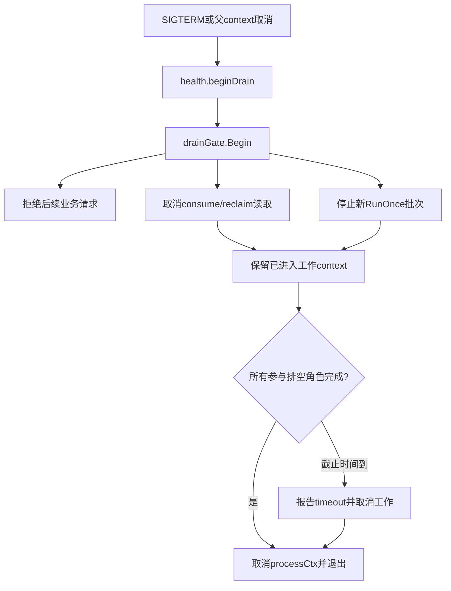

# 单主机多容器实例可用性 — 设计文档

## 拓扑、身份和故障对象

```text
H1
├─ wecom-ha-entry                 宿主 58087 → 容器 8080
├─ wecom-ha-node-a (wecom-local)  宿主 58088 → 容器 8080
├─ wecom-ha-node-b (wecom-local)  宿主 58089 → 容器 8080
├─ wecom-ha-bootstrap            一次性配置/技能初始化
└─ 共享 PostgreSQL、Redis 及本地配置要求的依赖
```

固定 instance_id 标识部署槽位；新 process_start_id 区分同槽位的新进程。owner 是 webui-local-<component>-<instance>-<process>。Worker/Relay/Delivery owner 变化不改变业务 request/session/DeliveryKey。

## 共享与隔离的实际配置

| 资源 | 当前配置 | 正确性 |
|---|---|---|
| 数据与协调 | 相同 PG DSN、Redis address/environment | 两节点可见相同 durable 工作与 lease；业务按 tenant 隔离。 |
| 根文件系统 | read_only:true | 禁止把恢复事实留在容器根目录。 |
| 私有可写目录 | /tmp tmpfs 256MiB，mode1777 | 每容器独立的密钥投影和临时文件。 |
| 技能内容 | bootstrap RW；四个多实例应用 RO | 原子发布不可变内容，读节点不修复目录。 |
| 停止 | restart:no；stop_grace_period 默认45s | 演练故障节点保持停止；计划停止给应用排空窗口。 |
| 宿主端口 | entry58087、A58088、B58089 | 容器内同端口可共存，用户地址不改。 |

没有新增节点本地业务表。所有恢复状态复用 [会话数据表](../conversation-continuity/design.md) 与 [在途数据表](../inflight-task-takeover/design.md)。技能卷也不能用来保存 session、lease、任务或待发回复。

## 稳定入口的当前算法

`wecomHAEntry` 对每个后端并行执行有超时的 `/readyz` 探测。HTTP 200、响应有效且探测 context 未失效才算成功；探测 body 最多读取 1024 字节。每次探测记录开始时的 epoch，较新的失败会递增 epoch，旧结果因 epoch 不匹配被丢弃。

路由须满足健康且 `checked_at` 未过期。初次成功可立即纳入；探测/转发失败或健康过期后需连续成功次数达到阈值。健康有效期为 `3 × (ProbeInterval + ProbeTimeout)`。epoch 是进程内竞态控制字段，不在 /statusz 中公开。

`serveHTTP` 只为 callback 路径做转发。正文上限 2 MiB；按轮转起点选择有效健康节点，每次回调对每个节点最多一次。网络失败、502/503/504、非 4xx 的响应读取失败或超限会摘除该后端并尝试另一节点。4xx 拒绝不切换，4xx body 读取失败时仍返回该状态；客户端取消不据此惩罚后端。完整响应缓冲成功后才写给客户端。

`forward` 保留 RequestURI、正文和签名相关头，`copyHeaders` 去掉逐跳头及 Connection 指定的头，不新增 X-Forwarded-*，也不跟随重定向。入口重试靠后端 durable Inbox 去重；不能代替投递端的幂等协议。

## 入口内存模型与状态字段

| 字段 | 存放位置 | 语义 |
|---|---|---|
| URL | backend 快照 | 内部 origin。 |
| health atomic.Bool | 入口内存 | 基础健康标记，还须 checked_at 有效。 |
| checked_at / healthy_since | mutex 保护；status 输出 | 探测时间 / 本次纳入健康的起始时间。 |
| failures / last_failure | mutex 保护；status 输出 | 累计失败及脱敏原因。 |
| consecutive_successes | mutex 保护；status 输出 | 故障后连续成功次数。 |
| epoch | mutex 保护，不输出 | 拒绝旧探测覆盖新失败。 |
| next | atomic.Uint64，不输出 | 轮转起点，先取模再转换避免溢出。 |

探测 TTL、epoch 是入口进程内状态；入口重启后重新探测，不能被用作 durable 任务执行权。

| 配置 | 默认值 | 校验 / 行为 |
|---|---|---|
| TRPC_LISTEN_ADDRESS | :8080 | 非空，无首尾空白。 |
| TRPC_WECOM_HA_ENTRY_BACKENDS | 必填 | 至少两个不同 http origin；拒绝 user/query/fragment/path，含尾斜杠路径也拒绝。 |
| TRPC_WECOM_HA_ENTRY_PROBE_INTERVAL | 1s | 100ms–1m。 |
| TRPC_WECOM_HA_ENTRY_PROBE_TIMEOUT | 1s | 100ms–30s。 |
| TRPC_WECOM_HA_ENTRY_REQUEST_TIMEOUT | 2s | 100ms–30s，每后端一次转发。 |
| TRPC_WECOM_HA_ENTRY_RECOVERY_SUCCESSES | 2 | 1–10，仅恢复阶段要求连续成功。 |
| HealthTTL | 派生值 | 3×(interval+probe timeout)，没有单独环境变量。 |

## SIGTERM 排空顺序

`signalCtx` 接收 SIGTERM/父 context 取消；活动工作使用独立 `processCtx`。主运行时先 `health.beginDrain()`，再 `drainGate.Begin()`，同时调用 HTTP Shutdown 并等待参与排空的角色退出。业务 HTTP 在排空期间返回 503，live/ready/status 路径可检查；ready 不会被迟到的成功轮询恢复成 true。

Worker、Delivery 和 Wakeup 的读取 context 先取消，活动工作 context 保留。预处理和 Relay 通过 drainPoll 停止下一批；Delivery Supervisor 停止 refresh/新建消费者，runUntilDrained 不重启已排空的消费者。活动进度发布在最终 processCtx 取消时退出。

默认排空 30 秒；Worker/Delivery 的局部超时装配为应用时限加 1 秒，让主运行时先控制全局期限。正常结束后取消 processCtx；超时则报告排空超时、取消工作并退出。未完成的 durable 工作留给存活节点。排空不是共享队列清零，也不会人工删除 lease。SIGKILL 完全跳过本流程。

## 健康与生命周期状态



入口首次成功可纳入；故障/过期后的 ready 节点还要经过连续成功窗口。SDK 和数据库恢复状态不依赖入口是否仍保留旧健康快照。

## 竞态与不承诺

旧探测不复活失败后端；draining 后健康成功不复活节点；监督器不重建已排空消费者；旧 owner 被业务 fence/CAS 拒绝。外部副作用和 P4 仍须协议保护。宿主机、入口、共享依赖故障及长期容量需独立设计/测量，不属于双应用实例故障承诺。

## 准入、读循环与活动工作之间的关系



gate解决准入和已有活动数的并发，context解决实际操作的取消。只关闭gate不会让阻塞读取醒来；只取消context又可能把活动发送立即中断，所以两者配合。

## gate的状态与不变量

| gate状态 | Enter | 已取得leave的活动 | Done |
|---|---|---|---|
| 运行中 | 可增加active | 完成时leave减少active | 尚不代表正在排空。 |
| Begin且active>0 | 拒绝 | 继续至完成/取消 | 等最后一个leave。 |
| Begin且active=0 | 拒绝 | 无 | 关闭。 |

leave通过sync.Once保护，重复调用不重复减计数；Begin后不会再次开放。应用同时还等待角色goroutine退出，而不是单凭一个gate计数推断所有后台工作完成。

## 三种owner不应混为一谈

instance/process owner标识具体进程角色；会话lease owner标识当前会话执行权；Ledger claim_owner标识当前发送权。它们通常带同一节点启动前缀，但生命周期和故障恢复条件不同。

入口backend URL标识一个槽位服务地址，也不是这些owner。相同URL在节点重启后仍可用，但process_start_id已变化；status应同时保留这两种观察。

## readiness观察的时序竞态

draining后再来的成功poll会被runtimeHealth忽略，防止退出期间恢复ready。Delivery Supervisor用generation排除旧consumer观察，防止旧goroutine的成功或退出污染新consumer状态。

入口再增加epoch和健康有效期，处理另一层时序：callback失败后旧probe不能成功复活节点。三种防护针对不同对象，不能因为已经有一个mutex就省略状态代次判断。

## 文件资源设计中的可写范围

| 路径/资源 | 写入者 | 读者 | 生命周期 |
|---|---|---|---|
| 技能发布目录 | bootstrap写入并原子发布 | 应用只读 | 跨应用进程保留不可变版本。 |
| stagingRoot/.publishing | bootstrap的本次临时发布 | 不作为正式包摘要根读取 | 未完成内容不应作为已发布版本。 |
| 容器/tmp | 当前容器进程 | 当前容器 | 容器私有，允许丢失。 |
| PG/Redis业务与协调 | 按协议的多角色 | 所有授权节点 | 任务和接管事实共享。 |

read_only root不是数据加密措施，tmpfs也不替代租户密钥scope。它们解决本地写入和实例冲突，业务安全仍依赖身份、密钥与数据库约束。

## 配置变更对状态机的影响

probe interval/timeout影响HealthTTL及摘除时延，recoverySuccesses影响重新纳入等待；这些是入口策略。lease/reclaim影响旧工作回收；这些是执行策略。drain timeout与Compose grace影响计划停止。

如果同时修改多组参数，观察到恢复更快/更慢时难以归因。发布记录应写明每个参数，并按实际故障窗口比较，而不是只比较一个总耗时。

## 设计约束如何对应反例

| 不变量 | 破坏后的反例 | 对应检查 |
|---|---|---|
| 业务事实不在私有目录 | 节点退出后原输入/结果不可读 | 共享记录与私有tmpfs审查。 |
| 新进程不复用旧身份 | 日志/claim无法区分重加入前后 | process_start_id变化。 |
| 入口只选有效健康节点 | 探测停滞仍不断转发故障节点 | checked_at过期判断。 |
| 排空后不新建消费者 | 维护期间任务继续被新领取 | Supervisor drain回归。 |
| sent不自动重发 | 重加入重放旧reply产生重复 | Ledger与客户端证据。 |
